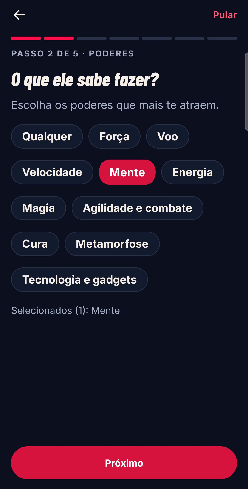
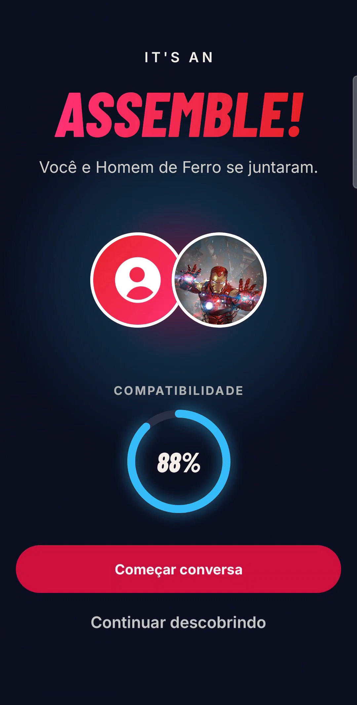
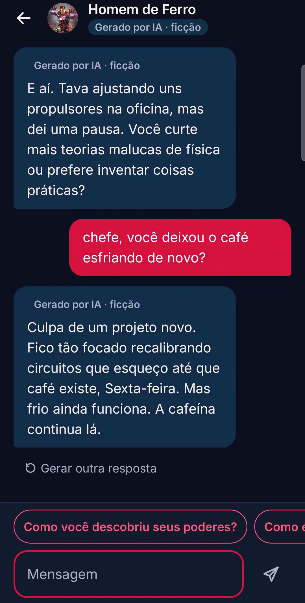
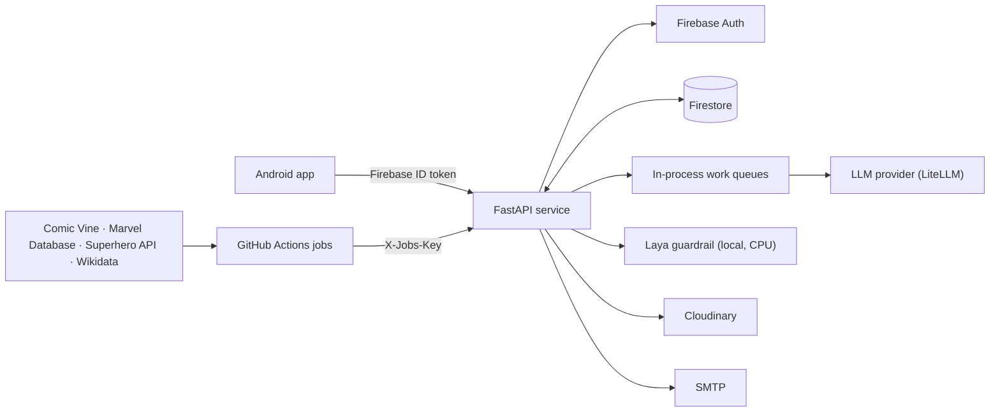

<div align="center">

# Assemble API

**The backend of Assemble: a daily deck of fictional comic characters, a decision engine, and in-character AI conversations.**

[](https://github.com/felipeirl/assemble-api/actions/workflows/deploy.yml)
[](https://github.com/felipeirl/assemble-api/releases)
[](https://www.python.org/)
[](https://fastapi.tiangolo.com/)
[](LICENSE)

[Overview](#overview) · [Features](#features) · [Architecture](#architecture) · [Getting started](#getting-started) · [API](#api) · [Testing](#testing) · [Deployment](#deployment) · [Releases](#releases)

</div>

---

Assemble is a mobile app where each day a user receives a deck of comic characters. They decide to **pass** or to **Assemble** with each one. When both sides are compatible, the character starts a conversation, written in character by an AI model. This repository is the only server behind the app: it verifies Firebase sign-ins, stores everything in Firestore, runs the decision engine, and generates the conversations.

> [!IMPORTANT]
> This is an independent, non-commercial project. It is not affiliated with, sponsored by, or endorsed by Marvel, Comic Vine, or any publisher. Every conversation is AI-generated fiction. The Android client lives in [felipeirl/assemble-app](https://github.com/felipeirl/assemble-app).

## Screenshots

<table>
  <tr>
    <td align="center"><br/><sub>Onboarding</sub></td>
    <td align="center"><br/><sub>Daily deck</sub></td>
    <td align="center"><br/><sub>Assemble and compatibility</sub></td>
    <td align="center"><br/><sub>In-character chat</sub></td>
    <td align="center"><br/><sub>Connections</sub></td>
  </tr>
</table>

## Overview

| Concern | How it is handled |
| --- | --- |
| **Identity** | Firebase ID tokens verified server-side with the Admin SDK. Deactivated accounts are purged on a schedule. |
| **Deck** | A deterministic daily selection (40 characters per user per day), built from the catalog and the user's taste signals. |
| **Decisions** | A pure function scores compatibility, affinity, and chance (weights `0.6 / 0.3 / 0.1`, cutoff `0.55`). It has no I/O and is covered by unit tests. |
| **Conversations** | Asynchronous. The API answers `202` immediately; a work queue generates the reply and writes it to Firestore. |
| **Safety** | A local guardrail model ([Laya](https://pypi.org/project/laya/)) screens user input and model output. Reports of sexual violence receive a fixed response with support hotlines, without calling the model. |
| **Memory** | Long conversations are summarized in batches, so the persona keeps context without an unbounded prompt. |
| **Privacy** | Zero-data-retention requests to the model provider. Access logs are kept for 180 days, as required by Brazil's Marco Civil da Internet. |

## Features

- **Daily deck** with one decision per character per day, undo for the last pass, and passes that return the next day.
- **Mutual compatibility**: an Assemble becomes a connection when the score clears the cutoff. Characters can also propose an Assemble on their own (“overtures”), every 30 minutes.
- **Conversations in character**, with regenerate, rewind, and suggested replies. Every bot message is labeled as generated fiction.
- **Onboarding** with a "this or that" reaction round that teaches taste without counting as a decision.
- **Catalog ingestion** from Comic Vine, the Marvel Database (Fandom), the Superhero API, and Wikidata, with Portuguese translations of descriptions.
- **Account lifecycle**: e-mail verification over SMTP, deactivation with a purge date, reactivation, and chat hiding.
- **Media**: profile photos go straight from the client to Cloudinary through signed uploads.
- **Operations**: `/health` and `/ready` endpoints, a load-test script, and scheduled jobs in GitHub Actions authenticated with a shared key.

## Architecture



The code is layered so that business rules do not depend on infrastructure:

```
app/
  main.py        FastAPI app, routers, warm-up of the guardrail model
  config.py      typed settings (pydantic-settings)
  container.py   wiring of stores, providers, and services
  api/           HTTP routes and response schemas (the /v2 contract)
  services/      use cases: deck, decisions, conversations, onboarding, accounts
  domain/        pure logic: compatibility, deck construction, match decision
  store/         document store abstraction (Firestore; in-memory for tests)
  ai/            LLM client, guardrail, persona prompts, conversation memory
  catalog/       ingestion and normalization from external sources
data/            versioned lookup tables (powers, teams, origins, tiers)
tests/           475 tests, run against in-memory fakes, no network calls
```

## Tech stack

| Area | Choices |
| --- | --- |
| Language and runtime | Python 3.12, `uv` for dependency management with a lockfile |
| API | FastAPI, Pydantic v2, Uvicorn |
| Identity and data | Firebase Authentication, Cloud Firestore (Admin SDK), security rules tested in the emulator |
| AI | LiteLLM (OpenAI-compatible provider), Laya guardrail on CPU PyTorch |
| Integrations | Comic Vine, Marvel Database (Fandom), Superhero API, Wikidata, Cloudinary, SMTP |
| Quality | Ruff (lint and format), pytest, GitHub Actions |
| Delivery | Docker (`python:3.12-slim`, non-root user), Discloud, Google Cloud Run (manual workflow) |

## Getting started

**Requirements:** Python 3.12, [uv](https://docs.astral.sh/uv/), and a Firebase service account with Firestore enabled.

```bash
git clone https://github.com/felipeirl/assemble-api.git
cd assemble-api
uv sync
cp .env.example .env        # then fill in the values (see Configuration)
uv run uvicorn app.main:app --reload
```

Check that the service is up:

```bash
curl http://127.0.0.1:8000/health
# {"status":"ok"}
```

The server refuses to start without `FIREBASE_SERVICE_ACCOUNT_JSON`. Routes that depend on a missing provider key return `503 provider_unavailable` instead of failing at boot.

### Docker

```bash
docker build -t assemble-api .
docker run --env-file .env -p 7860:7860 assemble-api
```

The image preloads the guardrail weights, so the first request after a cold start does not download them.

## Configuration

Settings are read from environment variables (or `.env`). The full list with defaults is in [`app/config.py`](app/config.py) and [`.env.example`](.env.example).

**Required**

| Variable | Purpose |
| --- | --- |
| `FIREBASE_SERVICE_ACCOUNT_JSON` | Admin SDK credentials, as a single-line JSON string |
| `COMMANDCODE_API_KEY`, `COMMANDCODE_BASE_URL` | LLM provider for chat |
| `CHAT_MODEL`, `CHAT_FALLBACK_MODEL` | Chat model and fallback |
| `PERSONA_MODEL` | Model used by the jobs that write persona sheets |
| `COMICVINE_API_KEY` | Catalog ingestion |
| `JOBS_KEY` | Shared secret for `/jobs/*` |
| `DEFAULT_TIMEZONE` | Day boundary for the deck (default `America/Sao_Paulo`) |

**Common optional settings**

| Variable | Default | Purpose |
| --- | --- | --- |
| `DECK_SIZE` | `40` | Characters per user per day |
| `MESSAGES_PER_HOUR` | `60` | Chat messages per user per hour |
| `MATCH_CUTOFF` | `0.55` | Score needed for a mutual Assemble |
| `REQUIRE_EMAIL_VERIFICATION` | `true` | Block e-mail/password accounts until the address is confirmed |
| `SMTP_HOST`, `SMTP_PORT`, `SMTP_USER`, `SMTP_PASSWORD` | `smtp.gmail.com`, `587` | Verification e-mail (a Gmail app password works) |
| `CLOUDINARY_CLOUD_NAME`, `CLOUDINARY_API_KEY`, `CLOUDINARY_API_SECRET` | empty | Profile photos; without them, photos are stored in Firestore |
| `GUARDRAIL_ENABLED`, `GUARDRAIL_THRESHOLD` | `true`, `0.5` | Guardrail switch and blocking threshold |
| `MEMORY_MODEL`, `MEMORY_BATCH_SIZE`, `MEMORY_CHUNK_SIZE` | see `app/config.py` | Conversation summarization |

## API

The versioned contract lives in [`docs/api-contract.md`](docs/api-contract.md) (in Portuguese); it takes precedence over this summary.

| Method | Route | Description |
| --- | --- | --- |
| `GET` | `/health` | Liveness probe |
| `GET` | `/ready` | Readiness: guardrail state and queue depths (`503` while loading) |
| `GET` | `/v2/deck` | Today's deck |
| `POST` | `/v2/decisions` | `PASS` (`204`) or `ASSEMBLE` (`202`, resolved asynchronously) |
| `POST` | `/v2/decisions/undo` | Undo the last pass of the day |
| `GET` | `/v2/characters/{id}` | Character preview or full profile |
| `POST` | `/v2/connections/{id}/messages` | Send a message (`202`, reply generated in the background) |
| `POST` | `/v2/connections/{id}/messages/regenerate` | Replace the last bot reply |
| `POST` | `/v2/connections/{id}/messages/rewind` | Delete messages after a bot reply |
| `GET` | `/v2/onboarding/reaction-cards` | Onboarding reaction round |
| `PUT` | `/v2/taste-signals/{id}` | Record a taste signal |
| `POST` | `/v2/account/email-verification` | Resend the verification e-mail |
| `POST` | `/v2/account/deactivate` / `reactivate` | Deactivate (with purge date) or reactivate an account |
| `POST` | `/v2/chats/hide` | Hide all chats |
| `GET` | `/v2/me/stats` | Counters for the profile and achievements |
| `POST` | `/jobs/{ingest,personas,translations,purge,overtures}` | Scheduled work; requires `X-Jobs-Key` |

Errors use a stable shape with machine-readable codes, for example `reply_pending`, `nothing_to_undo`, and `provider_unavailable`.

## Testing

```bash
uv run pytest                  # 475 tests, in-memory store, fake auth and LLM
uv run ruff check .            # lint
uv run ruff format --check .   # formatting
```

Firestore security rules are tested against the emulator (requires Node 20+ and Java 21+):

```bash
cd firestore-tests && npm install && npm test
```

Tests make no external calls. The fakes for Firebase Auth, the LLM, and the guardrail make the suite deterministic and fast.

## Deployment

| Target | Status | How |
| --- | --- | --- |
| **Discloud** | Production | Site deployed from `main` with [`discloud.config`](discloud.config). See [`docs/discloud.md`](docs/discloud.md). |
| **Docker** | Supported | `Dockerfile` at the repository root. |
| **Google Cloud Run** | Manual | `workflow_dispatch` job in [`deploy.yml`](.github/workflows/deploy.yml), gated on tests and rules. See [`docs/cloud-run.md`](docs/cloud-run.md). |
| **Local with a tunnel** | Development | [`docs/local-run.md`](docs/local-run.md) |

Every push to `main` runs lint, format check, tests, and the Firestore rules suite in GitHub Actions. Scheduled jobs (catalog ingestion, persona sheets, translations, purge) run from [`jobs.yml`](.github/workflows/jobs.yml).

## Releases

Versions follow a simple odometer scheme: each release is a meaningful addition, and the number advances one step at a time (`0.0.9 → 0.1.0`). Notes for every version are in [CHANGELOG.md](CHANGELOG.md), which follows [Keep a Changelog](https://keepachangelog.com/en/1.1.0/). Releases are published on the [Releases page](https://github.com/felipeirl/assemble-api/releases).

## Known limitations

- The queues run in-process. They are fast for a single instance, but horizontal scaling would need a shared queue.
- The guardrail model (about 650 MB) makes cold starts slow on small instances. The Docker image preloads it for this reason.
- Catalog content depends on third-party APIs and their terms of use.
- Persona content is generated by a language model and is fiction by design.

## Project layout

```
.github/workflows/   CI and deployment, scheduled jobs
app/                 application code (see Architecture)
data/                versioned reference tables
docs/                API contract, run and deploy guides, portfolio screenshots
firestore-tests/     security rules tests (Node, emulator)
scripts/             smoke test, load test, demo account helpers
tests/               unit and integration tests
```

## Contributing

Issues and pull requests are welcome. Read [CONTRIBUTING.md](CONTRIBUTING.md) before opening a PR, and report vulnerabilities as described in [SECURITY.md](SECURITY.md).

## License

Released under the [MIT License](LICENSE).
